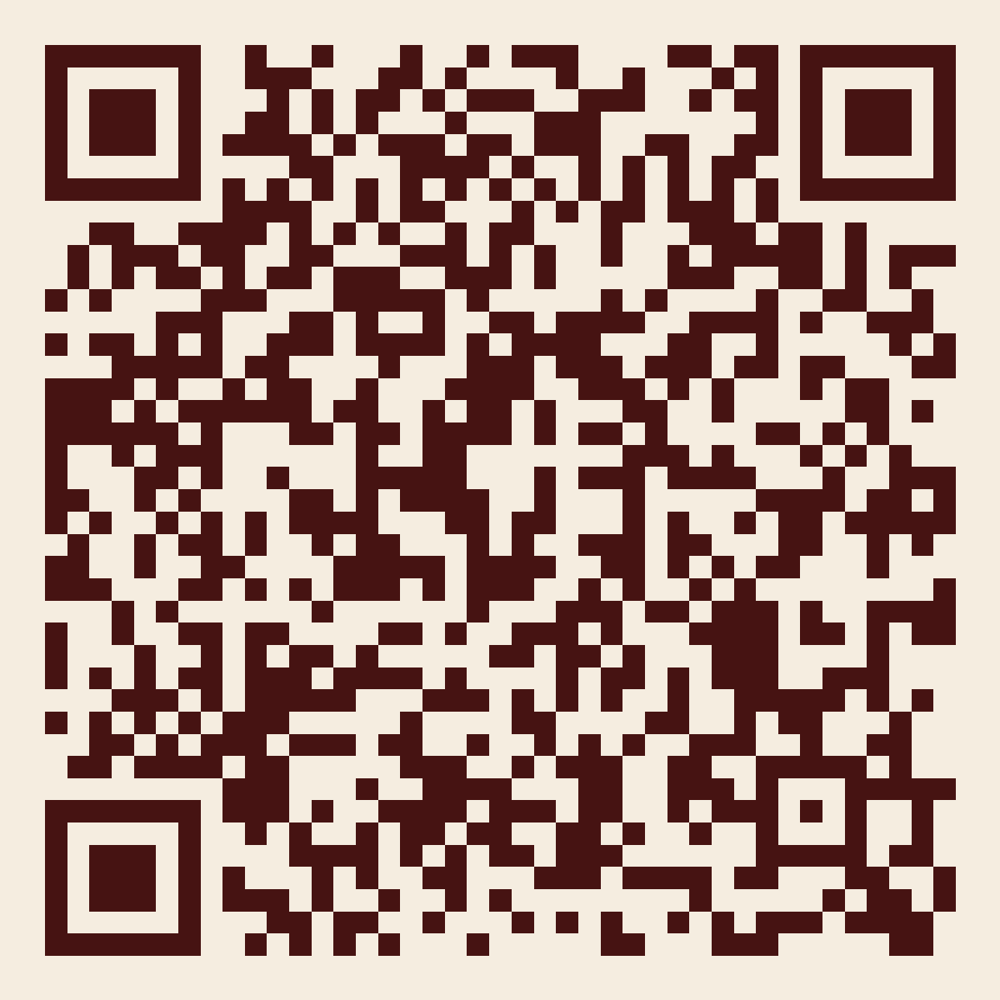

# Entre Elas · Lumina Comunicação

Cartão de visita 3D da Lumina Comunicação para quem participou do Entre Elas. O cartão acende, mostra o presente de 25% off com o cupom `ENTREELAS25` e leva ao WhatsApp da Lumina com a mensagem pronta.

## Link de acesso

**https://marcoscarvalho04.github.io/entre-elas/**

É este o endereço para divulgar. O QR Code abaixo aponta para ele:

- **Para imprimir:** `qrcode-entre-elas.svg`, um vetor que serve para gráfica, banner ou totem.
- **Para telas e posts:** `qrcode-entre-elas.png`, com 1200×1200 px.

O link e o QR Code continuam valendo depois de cada atualização.

## Como atualizar

A página é um arquivo só, o `index.html`, publicado pelo GitHub Pages a partir da branch `main`. Para atualizar, basta mandar a nova versão do arquivo para a `main`. O site atualiza em 1 a 2 minutos, no mesmo endereço.

## Versões

| Versão | Data | O que é | Como recuperar |
|---|---|---|---|
| `v1` | 05/11/2026 | Primeira versão publicada. Fontes Bodoni Moda e Jost. O cartão vira sozinho e aparece "Veja o seu presente". | `git checkout v1 -- index.html` |
